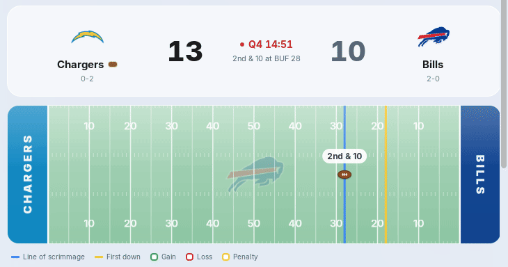
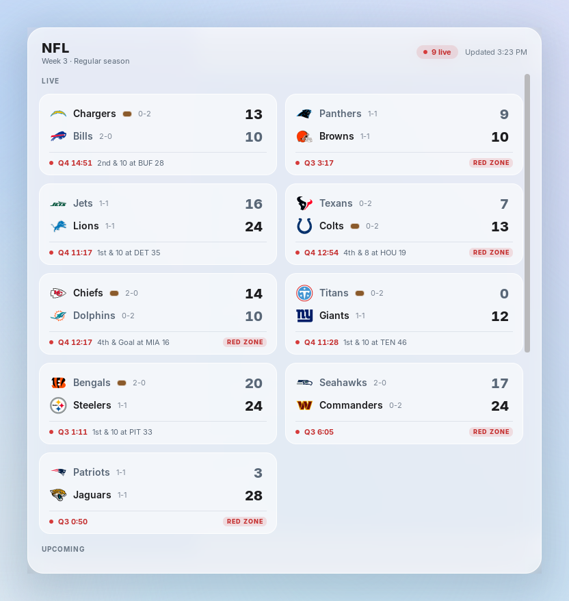
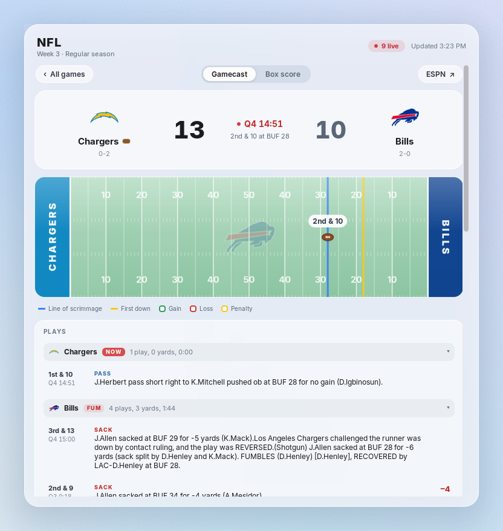
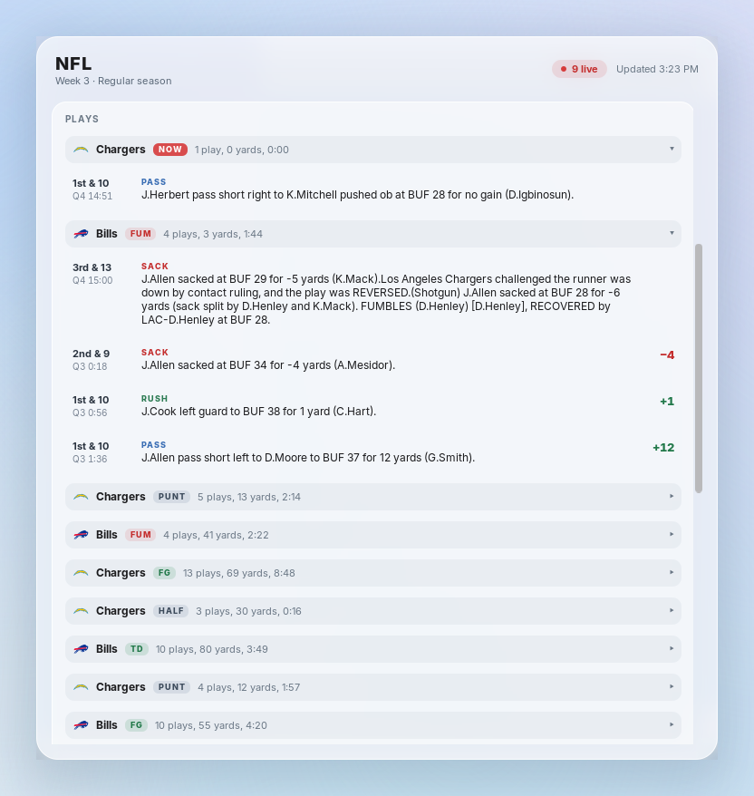
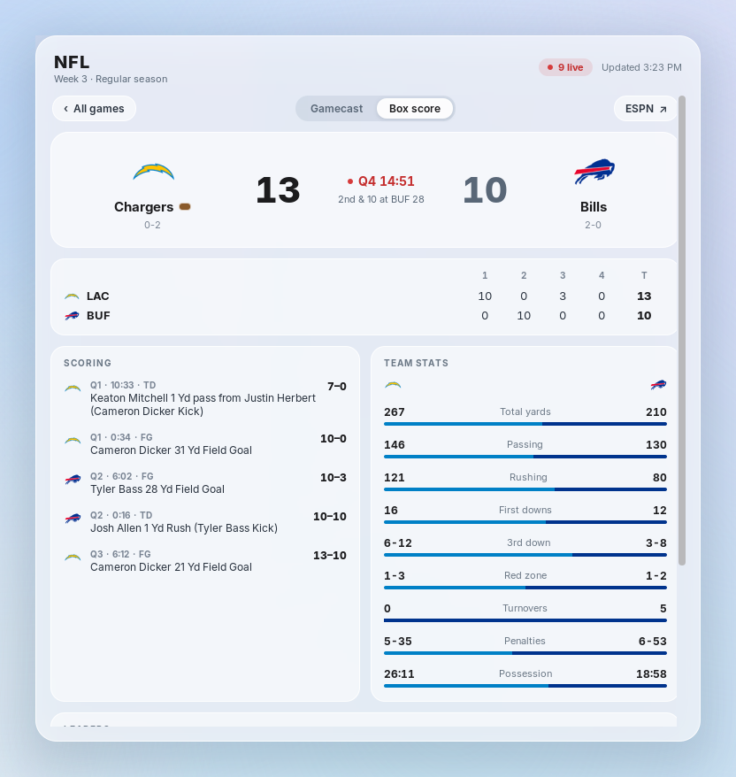
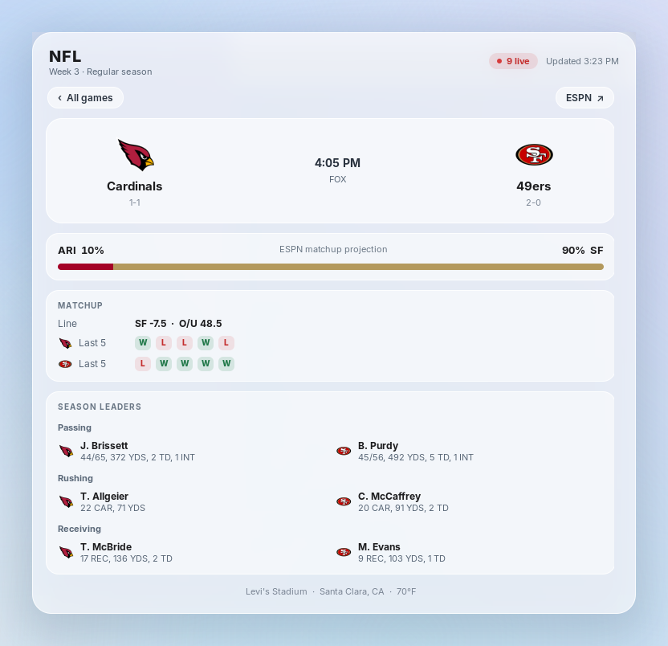

<div align="center">

# NFL Scores

**Live NFL scores and a drawn-on-the-field gamecast for GNOME Shell.**<br>
Press <kbd>Super</kbd> + <kbd>F</kbd> to open it and press it again to close it.




</div>

## Features

<table>
<tr>
<td width="50%" valign="top">

### Every game at a glance
Live games first, then upcoming games, then finals. Each card shows the clock, down and distance, which team has the ball, and a red-zone tag. A score that just changed is highlighted for 30 seconds.

</td>
<td width="50%"></td>
</tr>
<tr>
<td width="50%"></td>
<td width="50%" valign="top">

### A gamecast drawn on the field
Click any game. The field shows the ball, the line of scrimmage, the first-down line, the red zone, and the current drive as a trail with a dot for each play.

New plays animate as they happen. Passes and kicks fly in an arc, and runs travel along the turf. A green or red streak and a floating "+12" show the yards gained or lost, then the lines slide to the next snap. Banners call out touchdowns, turnovers, sacks, field goals, first downs, and big plays.

</td>
</tr>
<tr>
<td width="50%" valign="top">

### Play by play
Plays are grouped by drive, newest first. Each one has down and distance, the clock, a colored type tag, and yards gained or lost. Scores and turnovers are highlighted. A play that arrived while you were watching gets a blue outline.

</td>
<td width="50%"></td>
</tr>
<tr>
<td width="50%"></td>
<td width="50%" valign="top">

### Box score
Points by quarter, every scoring play, a side-by-side team stats comparison, and the passing, rushing, and receiving leaders.

</td>
</tr>
<tr>
<td width="50%" valign="top">

### Before kickoff
ESPN's matchup projection, the betting line, each team's last five results, season leaders, the venue, and the weather.

</td>
<td width="50%"></td>
</tr>
</table>

The popup uses frosted liquid glass: a milky white surface with background blur, Inter type, and team colors only where they carry meaning. If two teams' main colors clash, like the Cardinals and 49ers, one switches to its alternate color so the field and the bars stay readable.

## Keyboard

| Key | Action |
| --- | --- |
| <kbd>Super</kbd> + <kbd>F</kbd> | Open or close the popup |
| Click a game | Open its gamecast |
| <kbd>Esc</kbd> / <kbd>Backspace</kbd> / <kbd>←</kbd> | Back to all games (or close, from the list) |
| <kbd>↑</kbd> <kbd>↓</kbd> <kbd>PgUp</kbd> <kbd>PgDn</kbd> | Scroll |

The game you had open stays open between presses of <kbd>Super</kbd> + <kbd>F</kbd>, so you can keep checking one game.

## Install

```bash
git clone https://github.com/ShaneKanterman04/nfl-scores.git
cd nfl-scores
make install
```

Log out and back in once so GNOME Shell discovers the extension. After that, press <kbd>Super</kbd> + <kbd>F</kbd>.

To use a different shortcut:

```bash
gsettings --schemadir ~/.local/share/gnome-shell/extensions/nfl-scores@shanekanterman/schemas \
  set org.gnome.shell.extensions.nfl-scores toggle-scoreboard "['<Super>g']"
```

## Data and network use

Scores come from ESPN's public endpoints. There's no account, no API key, and no tracking.

| When | What | Size |
| --- | --- | --- |
| Popup closed | Nothing | — |
| Popup open | Scoreboard every 20 s while any game is live, otherwise every 5 min | ~200 KB |
| Game open | That game's summary on the same schedule, or every 15 s for a live gamecast | ~450 KB |
| Watching a live gamecast | Play count every 5 s; a new play triggers an immediate refresh | ~2 KB |
| First time a team appears | Its logo at 96 px, kept in `~/.cache/nfl-scores/logos` | ~5 KB |

The extension uses `site.web.api.espn.com`. The better-known `site.api.espn.com` rejects every client except curl.

## Development

GNOME Shell caches extension code for the whole session, which normally means logging out to see any change. Here, `extension.js` is a small loader that imports the rest with each file's modification time in the URL, so a reload loads fresh code and CSS.

```bash
make reload        # install and reload in the running shell, no logout
make lint          # syntax-check every module and the schema
make check-live    # print the live scoreboard and one game's detail as parsed
make render        # draw the field and charts for saved games to /tmp/nfl-render
make screenshots   # recapture every image in this README from the running shell
gjs -m scripts/render-fixtures.js --frames   # play animations as filmstrips
```

`make screenshots` asks the running extension to photograph its own popup with GNOME Shell's screenshot API. It records a touchdown replay for the GIF above. While it captures, it paints a neutral backdrop behind the popup, so none of your windows end up in the images.

| File | Role |
| --- | --- |
| `extension.js` | Loader and the <kbd>Super</kbd> + <kbd>F</kbd> keybinding |
| `scoreboard.js` | Popup: the list, game detail and gamecast views, refresh and play detection |
| `games.js` | ESPN parsing, field state, and play events. No GNOME imports, so it runs under node |
| `draw.js` | Cairo drawing of the field, animations, win probability, and drive chart. Runs without GNOME Shell |
| `field.js` | St widgets around `draw.js`, including the play animation timeline |
| `capture.js` | The screenshot tool behind `make screenshots` |
| `stylesheet.css` | The glass styling |

Every ESPN yard line counts from the home team's goal line (0) to the away team's (100). That was checked against the spot text of every play in the saved games.

## Credits

Not affiliated with or endorsed by the NFL, ESPN, or any team. Team names, logos, and data belong to their owners and are shown only to display scores.
